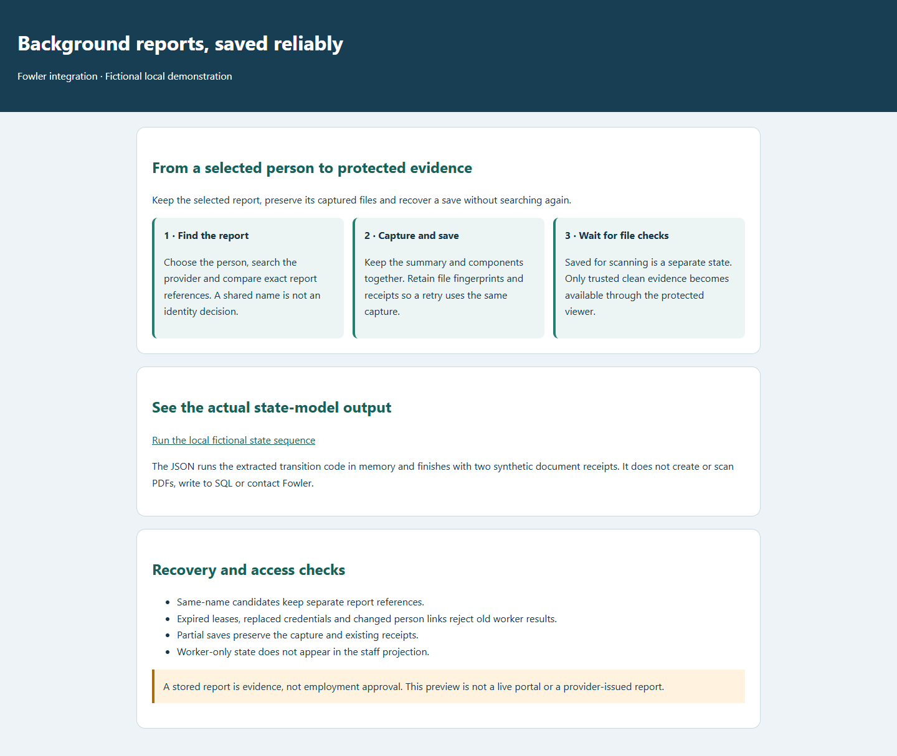
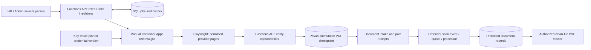

# Fowler Background Reports: Reliable Retrieval and Protected Evidence

**Find the right existing report, save every part and recover interrupted work without ordering or searching again.**

[The problem](#the-business-problem) · [The solution](#the-solution) · [What was built](#what-was-built) · [Proof it works](#proof-it-works) · [Step by step](#step-by-step)



## The Business Problem

HR needs to review an applicant's existing background report alongside their onboarding documents. When that report stays in a separate provider portal, staff have to find the person, distinguish similar names, open the report's separate components and bring the right evidence into the employee record. A report still being processed must remain distinguishable from one ready for review.

An interrupted browser session or failed upload can leave staff unsure which files were saved. Repeating the search adds work and can select a different report from the one originally reviewed. Saving a file also creates a separate responsibility: keep its ownership, report date and malware-check status clear before anyone opens it.

The business need was a dependable path from an exact provider result to protected, reviewable evidence, with recovery that preserves completed work and avoids unnecessary repeat retrievals.

## The Solution

I implemented a Fowler integration in an Azure workforce and operations platform. Staff choose a person, find and select an exact provider result, capture its summary and components, then save the same captured files through the protected document intake. Durable job records, file fingerprints and per-file receipts make retries deliberate and traceable.

**Business outcome:** Bring existing reports into the employee's record with clearer ownership, fewer repeated retrieval steps and a reliable recovery path. This is a qualitative implementation outcome; no time-saving percentage is claimed.

This public project includes selected implementation source and original offline tests. Deployment targets are replaced with examples, and applicant data, credentials and report contents are excluded. The local screenshots use fictional information; they are not screenshots of a live employee report.

## Tools Used and What They Do

| Tool or service | Purpose |
| --- | --- |
| Node.js and Playwright Chromium | Navigate the permitted provider pages and capture browser-rendered report PDFs. |
| React and TypeScript | Present person selection, report selection, progress, retries and the protected viewer in the actual application. |
| Azure Functions | Enforce staff/worker roles, current person links and allowed job actions. |
| Azure SQL | Store jobs, revisions, leases, selected results, receipts and append-only history. |
| Azure Container Apps Jobs, Docker and ACR | Package and run a separate, one-shot retrieval worker from a selected image. |
| Entra managed identity and Key Vault | Authenticate the worker and read the exact claimed credential version. |
| Blob Storage, Defender for Storage, Event Grid and queues | Preserve capture checkpoints and connect document intake to trusted file-scan processing. |
| Terraform, Azure CLI and GitHub Actions | Describe supporting infrastructure and release the selected build; public examples do not deploy it. |
| SHA-256 and Node's test runner | Bind each report part to its saved bytes and check selection/recovery behavior locally. |

The connection-check job and report-retrieval job are separate. Checking a saved connection does not search for an applicant, retrieve a report or place an order.

## Step by Step

Your own saved-PDF retrieval exercise with an exact fictional person/reference, a protected local provider stub and a capture manifest.

[Open the standalone build guide](docs/BUILD-YOUR-OWN.md) or follow the same complete instructions below.

Start with a new folder, your own files and your own accounts. The numbered steps below describe the build; no portfolio repository checkout is required. The existing implementation/evidence elsewhere in this repository is a separate reference, not a claim that your new build has already passed.

### Prerequisites

Python, ReportLab, requests and pypdf in a virtual environment. The local stub has no Fowler credentials, provider login or paid order capability; live vendor integration requires your own approved provider contract/API.

Use Bash on Linux/macOS/WSL for Bash blocks and PowerShell for PowerShell blocks. Select the tool versions supported by the official sources below, record the versions you actually install and retain generated dependency locks. Cloud resources, scanner downloads, logs and external AI calls can create costs; review the stated scope before enabling them.

### Create your project folder

Choose a new folder name. These first commands create a blank project; an optional `git init` gives it its own history. Create parent directories in your editor when a later step introduces a nested file.

```bash
mkdir my-fowler-background-report-retrieval
cd my-fowler-background-report-retrieval
git init
```

Create `.gitignore` before saving credentials or build outputs:

```gitignore
.venv/
node_modules/
.env
.env.*
local.settings.json
credentials.json
token.json
*.pem
*.key
*.tfstate*
*.tfplan
.terraform/
private*/
captures/
backups/
batch.json
reports/
out/
app-config.local.yaml
```

The source/file snippets are a starting implementation you type or paste into the named files. Replace `YOUR_*`, names, regions and addresses only with values from your own lab; do not place real client/employee records in a test project. Keep your terminal in this project root unless a step explicitly changes directory.

Before a first commit, set your own repository-local author with `git config user.name "YOUR_NAME"` and `git config user.email "YOUR_PUBLIC_COMMIT_EMAIL"`. Review `git status --short` and the staged diff before publishing; ignored local files are not a substitute for reviewing what you upload.

### Step 1 — Define the report ownership contract

**Where:** A new request.json file.

Write a stable fictional employee ID, provider reference and expected source host, keeping report creation/order separate from retrieval. A name match alone must not choose a background report.

Create **`request.json`** with the following contents:

```json
{"employee_id":"LAB-001","provider_reference":"REPORT-001","source":"local-provider-stub"}
```

**Check before continuing:** You can identify the exact permitted person/report pair.

### Step 2 — Create a PDF you own

**Where:** Your new project folder.

Install the libraries below and create make_report.py. This PDF is fictional test content, so no report or employee finding is published.

```bash
python3 -m venv .venv
.venv/bin/python -m pip install reportlab requests pypdf
.venv/bin/python -m pip freeze > requirements.lock.txt
```

Create **`make_report.py`** with the following contents:

```python
from pathlib import Path
from reportlab.pdfgen import canvas
Path('provider').mkdir(exist_ok=True)
c = canvas.Canvas('provider/report.pdf')
c.drawString(72, 740, 'FICTIONAL REPORT - LAB-001 - REPORT-001')
c.drawString(72, 710, 'Retrieval test only; no real background finding.')
c.save()
```

**Check before continuing:** provider/report.pdf is a real parseable PDF.

### Step 3 — Start your local provider stub

**Where:** One terminal in the project root.

Generate the PDF, then serve only the provider directory on loopback. This is a controlled file source for your worker, not a vendor authentication simulation.

```bash
.venv/bin/python make_report.py
.venv/bin/python -m http.server 8890 --bind 127.0.0.1 --directory provider
```

**Check before continuing:** The PDF is available only through your local test endpoint.

### Step 4 — Write your bounded retriever

**Where:** Your editor.

Create retrieve.py below. It admits one capture for this request, bounds and parses the PDF, stages the PDF/manifest together and publishes the pair by renaming its new local directory; it does not infer a background finding from report text.

Create **`retrieve.py`** with the following contents:

```python
from pathlib import Path
from datetime import datetime, timezone
import hashlib, io, json, tempfile, shutil
import requests
from pypdf import PdfReader
request = json.loads(Path('request.json').read_text())
if request != {'employee_id':'LAB-001','provider_reference':'REPORT-001','source':'local-provider-stub'}:
    raise ValueError('Review the exact fictional request before adapting this example')
root = Path('captures').resolve()
if root.parent != Path.cwd().resolve(): raise ValueError('Use a local lab captures folder')
root.mkdir(exist_ok=True)
final = root / 'LAB-001-REPORT-001'
lock = root / 'LAB-001-REPORT-001.lock'
lock.mkdir()  # exclusive admission before any retrieval
stage = None
try:
    if final.exists(): raise FileExistsError('Capture already exists; inspect it rather than retrieve again')
    with requests.get('http://127.0.0.1:8890/report.pdf', timeout=20,
                      stream=True, allow_redirects=False) as response:
        if response.status_code != 200: raise ValueError('PDF retrieval failed')
        data = bytearray()
        for part in response.iter_content(65536):
            data.extend(part)
            if len(data) > 10 * 1024 * 1024: raise ValueError('PDF exceeds limit')
    pdf = PdfReader(io.BytesIO(data), strict=True)
    if pdf.is_encrypted or not 1 <= len(pdf.pages) <= 100: raise ValueError('Unsupported PDF')
    manifest = {**request, 'retrieved_at': datetime.now(timezone.utc).isoformat(),
                'sha256': hashlib.sha256(data).hexdigest(), 'pages': len(pdf.pages)}
    stage = Path(tempfile.mkdtemp(prefix='.capture-', dir=root))
    (stage/'LAB-001-REPORT-001.pdf').write_bytes(data)
    (stage/'manifest.json').write_text(json.dumps(manifest, indent=2), encoding='utf-8')
    stage.rename(final)  # publish the complete pair on the same filesystem
    print({'saved': True, 'pages': len(pdf.pages)})
finally:
    if stage is not None and stage.exists():
        if stage.resolve().parent != root or not stage.name.startswith('.capture-'):
            raise ValueError('Unexpected cleanup target')
        shutil.rmtree(stage)
    lock.rmdir()
```

**Check before continuing:** The request is bound to one complete PDF/manifest directory; a second command cannot retrieve into the same destination concurrently.

### Step 5 — Run and inspect your saved evidence

**Where:** Second terminal in the same folder.

Run the retriever, open the PDF inside captures/LAB-001-REPORT-001 and compare manifest.json with the captured bytes. A repeat must stop before a second download; after a crash inspect the complete directory, any .capture- staging directory and the lab lock before deciding how to reconcile.

```bash
.venv/bin/python retrieve.py
sha256sum captures/LAB-001-REPORT-001/LAB-001-REPORT-001.pdf
```

**Check before continuing:** Your saved report and manifest match the exact fictional request.

### Step 6 — Define the live-provider and access extensions

**Where:** Your worker/API design.

Replace the stub only after obtaining your own approved provider interface and exact-record authorization. Add malware scanning, a durable hosted transaction/checkpoint and same-capture recovery, protected PDF access and safe failure stages before calling it a production retrieval service. The local directory rename/lock above demonstrates publication and duplicate protection; it is not a power-loss-safe hosted transaction or automatic stale-lock recovery.

**Check before continuing:** The tutorial's completed capture and the additional live-service controls are clearly separated.

### Step 7 — Record and close the lab

**Where:** Your terminals and files.

Save a value-free flow diagram and your successful/duplicate-failure observations, then stop the stub with Ctrl+C. Retain or remove only the fictional captures according to your lab retention decision.

**Check before continuing:** The reader can create the PDF source and retrieval worker without your existing report records.

### Verification and your own screenshots

| Evidence | What to record | Your result |
| --- | --- | --- |
| New build | Your own files/resource settings and tool versions | Not yet recorded |
| Working path | The actual successful request, configuration or recovery result | Not yet recorded |
| Failure boundary | A meaningful denied, malformed, stale or failed case | Not yet recorded |
| Recovery / cleanup | What you restored or removed and what remains billed | Not yet recorded |

Capture your own architecture/configuration, one working result and one failure/recovery result. Keep tokens, credentials, personal records and private identifiers out of public screenshots. Existing portfolio images are references, not evidence that you performed these steps.

### Troubleshooting order

1. Confirm the named file, working directory and selected tool/interpreter.
2. Check the exact input and resource/account selected for the failing step.
3. Separate identity permission, network/DNS reachability and application validation.
4. Keep the actual error and reconcile an unknown write outcome before repeating it; do not widen access or repeat paid operations blindly.

The numbered steps describe a build procedure. Local syntax checks, an accepted API request, a completed hosted operation and a human verification are different evidence levels; fill in the verification table with what you actually observed.

### Official implementation references

- [requests.readthedocs.io — advanced](https://requests.readthedocs.io/en/latest/user/advanced/)
- [pypdf.readthedocs.io — stable](https://pypdf.readthedocs.io/en/stable/)

The walkthrough layout follows the prerequisites → creation/configuration → test → verification → troubleshooting → cleanup pattern of the [Splunk project reference](https://github.com/davidharris6/splunk-siem-log-analysis). Its Splunk-specific settings are not copied into unrelated projects.

<details>
<summary>Reference: how the existing platform implementation operates</summary>

1. **Choose the person** — Open the employee or applicant record and start retrieval from that exact record. The server keeps the target link with the job and checks it again before accepting changes.

2. **Find an existing report** — The worker returns the provider's displayed candidates, report references and processing status. Staff compare the exact result; a surname or list position alone cannot select it.

3. **Capture the selected result** — The worker captures the summary and available components into a private checkpoint. Each part keeps its size and fingerprint so changed or incomplete bytes cannot silently replace it.

4. **Save and recover safely** — Staff request saving and the application retains each verified document receipt. An interrupted save resumes that same capture instead of generating new PDFs or repeating provider lookup.

5. **Wait for file checks and review** — The saved files enter the malware-check path before protected viewing. HR reviews the report separately; neither a clean scan nor a saved PDF makes an employment decision.

</details>

## Architecture



The worker sends capture bytes through the API; the deployment-owned Blob adapter verifies and writes the private checkpoint. The worker uses the API instead of receiving a SQL login. Its identity must match both its application role and configured worker identity. Request bodies cannot choose an arbitrary job, storage container or credential path.

## What Was Built

| Component | What it prevents | Public source |
| --- | --- | --- |
| Report candidate selection | Merging same-name people or choosing by row position | [Provider adapter](reference/report-retrieval.mjs) |
| Durable state rules | Overlapping claims, late worker results and invalid transitions | [Extracted state model](reference/source/fowlerRetrieval.ts) |
| Per-part evidence validation | Wrong hashes, missing components and mismatched record targets | [Evidence client](reference/careops-evidence.mjs) |
| Manual worker infrastructure | Defines one-shot execution and scoped job start; the full API separately rejects job overrides | [Related Terraform module](infra/modules/retrieval-worker/main.tf) |
| Fictional local demonstration | Makes the process inspectable without credentials or provider calls | [Run it](demo/run.mjs) |

The full SQL store, API authentication handlers, Blob adapter, React application and scan processor are not packaged as a standalone deployable application here. [Source map](docs/SOURCE-MAP.md) explains what is extracted and what remains part of the private platform.

## Proof It Works

```bash
# Node.js 22.13+; tested with 22.23.2 in .nvmrc
# No npm install or cloud credentials required
npm test
npm run demo
npm run preview
# Open http://127.0.0.1:8788 and stop with Ctrl+C
```

**Current local result: 27 tests passed** (18 extracted-source tests and 9 review regressions). The generated-code check also confirms the runnable model matches its TypeScript source.

The offline tests exercise exact selection, ambiguous names, changed links and credentials, lease expiry, incomplete captures, partial-save recovery and safe staff projections. The demonstration uses synthetic file manifests and receipts; it does not pretend those files passed a live scanner. [Validation record](docs/VALIDATION.md) gives the exact results and limits.

Historical platform acceptance included fictional hosted capture/save/scan/protected-download checks and an owner-confirmed existing-report retrieval. Those dated receipts are summarized without employee details in [implementation evidence](docs/IMPLEMENTATION.md); they are not a claim of a new live test from this repository.

## Troubleshooting Lessons

| Symptom | What the implementation taught us |
| --- | --- |
| Capture worked but saving failed | A multi-file summary was incorrectly labelled as a standalone report. Correct the role to `summary`, then retry the retained capture rather than fetching again. |
| Duplicate names or several reports | Preserve all distinct references and require exact selection. Discovery does not verify identity. |
| Saved but the evidence list looked stale | Refresh the evidence panel after confirmed save without unmounting the selected job. File-check status still comes from the server. |
| A timeout leaves the outcome unknown | Read the persisted job and receipts first. Do not blindly repeat a provider request or paid operation. |
| Missing dates or vague filenames | Capture time and the provider's actual report date are separate facts. Use descriptive labels without inventing an older report's date. |
| A PDF remains unavailable | Check scanner state, exact file proof, current permissions and person linkage. Never manually mark it clean or expose a checkpoint URL. |

## Strengths, Limits and Tradeoffs

- **Strengths:** exact report selection, durable recovery, immutable file checkpoints, dedicated identities and protected evidence handling.
- **Tradeoffs:** browser automation handles a provider without a suitable report API, but selectors and print layouts can change; retained checkpoints reduce repeated work but add storage and cleanup duties.
- **Limits:** the current durable lookup is surname-based, with staff identity review; the separate protected SSN helper is not commissioned by this project. Visible paging is retained, not a promise to search every provider page.
- **No paid orders:** existing-report retrieval and order drafts are separate from submitting a new order. This repository has no provider credentials or live order entrypoint.

## How the Design Could Scale

Use a bounded worker pool with one valid lease per job, provider-rate limits and queue-age alerts. Scale PDF storage and scan processing independently, retain idempotent receipts and exact target checks, and partition history only after measuring volume. More workers cannot bypass provider limits, ambiguous identity review or scan readiness; observed throughput and cost measurements are still required.

## Infrastructure and Operating Notes

The related [Terraform extraction](infra/README.md) describes a Manual, zero-retry worker, its managed identity, exact-secret access, API role, private staging container and checkpoint retention. It has no environment defaults or runnable root. Do not apply it to an account whose lifecycle policy has another owner: that is an account-wide resource and all existing rules must be preserved.

[Review and remaining limits](docs/REVIEW.md) · [Commands](docs/COMMANDS.md) · [Implementation](docs/IMPLEMENTATION.md) · [Source map](docs/SOURCE-MAP.md) · [Validation](docs/VALIDATION.md) · [Security](SECURITY.md)
