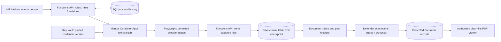

# Fowler Background Reports: Reliable Retrieval and Protected Evidence

**Find the right existing report, save every part and recover interrupted work without ordering or searching again.**

[The problem](#the-business-problem) · [The solution](#the-solution) · [What was built](#what-was-built) · [Proof it works](#proof-it-works) · [Step by step](#step-by-step)


## The Business Problem

HR needs to review an applicant's existing background report alongside their onboarding documents. When that report stays in a separate provider portal, staff have to find the person, distinguish similar names, open the report's separate components and bring the right evidence into the employee record. A report still being processed must remain distinguishable from one ready for review.

An interrupted browser session or failed upload can leave staff unsure which files were saved. Repeating the search adds work and can select a different report from the one originally reviewed. Saving a file also creates a separate responsibility: keep its ownership, report date and malware-check status clear before anyone opens it.

The business need was a dependable path from an exact provider result to protected, reviewable evidence, with recovery that preserves completed work and avoids unnecessary repeat retrievals.

## The Solution

I implemented a Fowler integration in an Azure workforce and operations platform. Staff choose a person, find and select an exact provider result, capture its summary and components, then save the same captured files through the protected document intake. Durable job records, file fingerprints and per-file receipts make retries deliberate and traceable.

**Business outcome:** Bring existing reports into the employee's record with clearer ownership, fewer repeated retrieval steps and a reliable recovery path. This is a qualitative implementation outcome; no time-saving percentage is claimed.

This public project includes selected implementation source and original offline tests. Deployment targets are replaced with examples, and applicant data, credentials and report contents are excluded. The local screenshots use fictional information; they are not screenshots of a live employee report.

## Tools Used and What They Do

| Tool or service | Purpose |
| --- | --- |
| Node.js and Playwright Chromium | Navigate the permitted provider pages and capture browser-rendered report PDFs. |
| React and TypeScript | Present person selection, report selection, progress, retries and the protected viewer in the actual application. |
| Azure Functions | Enforce staff/worker roles, current person links and allowed job actions. |
| Azure SQL | Store jobs, revisions, leases, selected results, receipts and append-only history. |
| Azure Container Apps Jobs, Docker and ACR | Package and run a separate, one-shot retrieval worker from a selected image. |
| Entra managed identity and Key Vault | Authenticate the worker and read the exact claimed credential version. |
| Blob Storage, Defender for Storage, Event Grid and queues | Preserve capture checkpoints and connect document intake to trusted file-scan processing. |
| Terraform, Azure CLI and GitHub Actions | Describe supporting infrastructure and release the selected build; public examples do not deploy it. |
| SHA-256 and Node's test runner | Bind each report part to its saved bytes and check selection/recovery behavior locally. |

The connection-check job and report-retrieval job are separate. Checking a saved connection does not search for an applicant, retrieve a report or place an order.

## Step by Step

Build an independent version with the [step-by-step build guide](docs/BUILD-YOUR-OWN.md). It gives prerequisites, working locations, numbered actions, source-derived commands, expected results, verification and cleanup.

For this project, your working starting point is [`tests/report-boundaries.test.mjs`](tests/report-boundaries.test.mjs). Expected scope: A fictional checkpoint/retrieval model; no provider lookup or paid report order.

1. **Create your own workspace.** Copy the project and record the source version before editing.
2. **Prepare and run the baseline.** Use the documented runtimes and selected dependencies, then run the local checks.
3. **Make your own change.** Edit a project-specific fixture, configuration or rule and rerun its positive and negative cases.
4. **Verify and document your result.** Capture your own evidence and distinguish a local example from a live integration.
5. **Extend and close out deliberately.** Plan any independent cloud work separately and clean up only what you created.

<details>
<summary>How the underlying platform process works</summary>

1. **Choose the person** — Open the employee or applicant record and start retrieval from that exact record. The server keeps the target link with the job and checks it again before accepting changes.

2. **Find an existing report** — The worker returns the provider's displayed candidates, report references and processing status. Staff compare the exact result; a surname or list position alone cannot select it.

3. **Capture the selected result** — The worker captures the summary and available components into a private checkpoint. Each part keeps its size and fingerprint so changed or incomplete bytes cannot silently replace it.

4. **Save and recover safely** — Staff request saving and the application retains each verified document receipt. An interrupted save resumes that same capture instead of generating new PDFs or repeating provider lookup.

5. **Wait for file checks and review** — The saved files enter the malware-check path before protected viewing. HR reviews the report separately; neither a clean scan nor a saved PDF makes an employment decision.

</details>

## Architecture



The worker sends capture bytes through the API; the deployment-owned Blob adapter verifies and writes the private checkpoint. The worker uses the API instead of receiving a SQL login. Its identity must match both its application role and configured worker identity. Request bodies cannot choose an arbitrary job, storage container or credential path.

## What Was Built

| Component | What it prevents | Public source |
| --- | --- | --- |
| Report candidate selection | Merging same-name people or choosing by row position | [Provider adapter](reference/report-retrieval.mjs) |
| Durable state rules | Overlapping claims, late worker results and invalid transitions | [Extracted state model](reference/source/fowlerRetrieval.ts) |
| Per-part evidence validation | Wrong hashes, missing components and mismatched record targets | [Evidence client](reference/careops-evidence.mjs) |
| Manual worker infrastructure | Defines one-shot execution and scoped job start; the full API separately rejects job overrides | [Related Terraform module](infra/modules/retrieval-worker/main.tf) |
| Fictional local demonstration | Makes the process inspectable without credentials or provider calls | [Run it](demo/run.mjs) |

The full SQL store, API authentication handlers, Blob adapter, React application and scan processor are not packaged as a standalone deployable application here. [Source map](docs/SOURCE-MAP.md) explains what is extracted and what remains part of the private platform.

## Proof It Works

```bash
# Node.js 22.13+; tested with 22.23.2 in .nvmrc
# No npm install or cloud credentials required
npm test
npm run demo
npm run preview
# Open http://127.0.0.1:8788 and stop with Ctrl+C
```

**Current local result: 27 tests passed** (18 extracted-source tests and 9 review regressions). The generated-code check also confirms the runnable model matches its TypeScript source.

The offline tests exercise exact selection, ambiguous names, changed links and credentials, lease expiry, incomplete captures, partial-save recovery and safe staff projections. The demonstration uses synthetic file manifests and receipts; it does not pretend those files passed a live scanner. [Validation record](docs/VALIDATION.md) gives the exact results and limits.

Historical platform acceptance included fictional hosted capture/save/scan/protected-download checks and an owner-confirmed existing-report retrieval. Those dated receipts are summarized without employee details in [implementation evidence](docs/IMPLEMENTATION.md); they are not a claim of a new live test from this repository.

## Troubleshooting Lessons

| Symptom | What the implementation taught us |
| --- | --- |
| Capture worked but saving failed | A multi-file summary was incorrectly labelled as a standalone report. Correct the role to `summary`, then retry the retained capture rather than fetching again. |
| Duplicate names or several reports | Preserve all distinct references and require exact selection. Discovery does not verify identity. |
| Saved but the evidence list looked stale | Refresh the evidence panel after confirmed save without unmounting the selected job. File-check status still comes from the server. |
| A timeout leaves the outcome unknown | Read the persisted job and receipts first. Do not blindly repeat a provider request or paid operation. |
| Missing dates or vague filenames | Capture time and the provider's actual report date are separate facts. Use descriptive labels without inventing an older report's date. |
| A PDF remains unavailable | Check scanner state, exact file proof, current permissions and person linkage. Never manually mark it clean or expose a checkpoint URL. |

## Strengths, Limits and Tradeoffs

- **Strengths:** exact report selection, durable recovery, immutable file checkpoints, dedicated identities and protected evidence handling.
- **Tradeoffs:** browser automation handles a provider without a suitable report API, but selectors and print layouts can change; retained checkpoints reduce repeated work but add storage and cleanup duties.
- **Limits:** the current durable lookup is surname-based, with staff identity review; the separate protected SSN helper is not commissioned by this project. Visible paging is retained, not a promise to search every provider page.
- **No paid orders:** existing-report retrieval and order drafts are separate from submitting a new order. This repository has no provider credentials or live order entrypoint.

## How the Design Could Scale

Use a bounded worker pool with one valid lease per job, provider-rate limits and queue-age alerts. Scale PDF storage and scan processing independently, retain idempotent receipts and exact target checks, and partition history only after measuring volume. More workers cannot bypass provider limits, ambiguous identity review or scan readiness; observed throughput and cost measurements are still required.

## Infrastructure and Operating Notes

The related [Terraform extraction](infra/README.md) describes a Manual, zero-retry worker, its managed identity, exact-secret access, API role, private staging container and checkpoint retention. It has no environment defaults or runnable root. Do not apply it to an account whose lifecycle policy has another owner: that is an account-wide resource and all existing rules must be preserved.

[Review and remaining limits](docs/REVIEW.md) · [Commands](docs/COMMANDS.md) · [Implementation](docs/IMPLEMENTATION.md) · [Source map](docs/SOURCE-MAP.md) · [Validation](docs/VALIDATION.md) · [Security](SECURITY.md)
